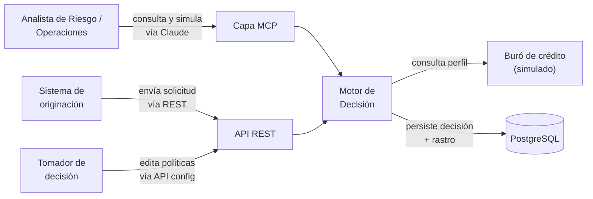
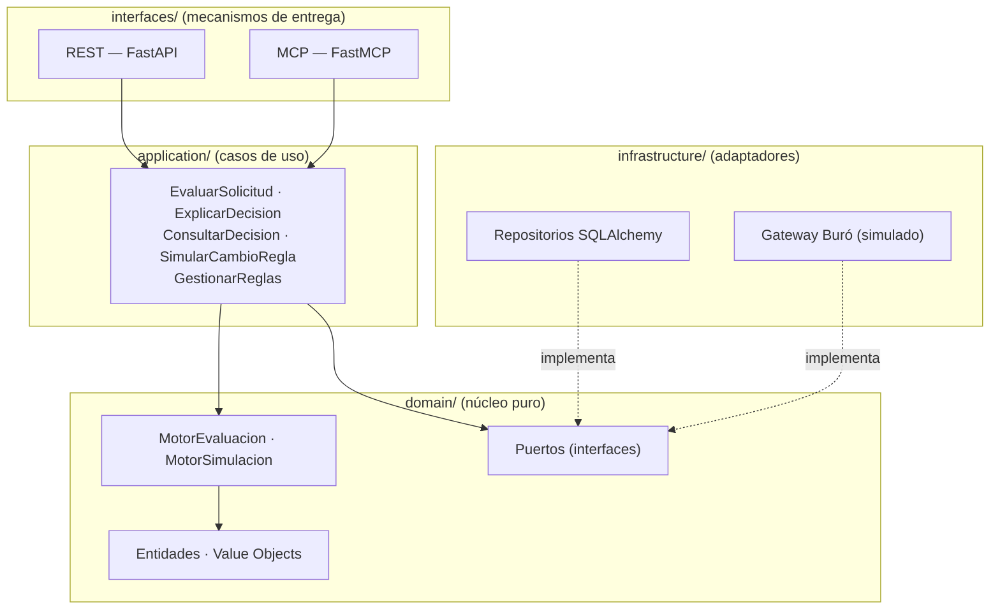
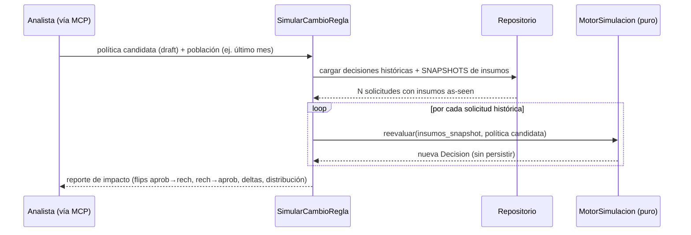
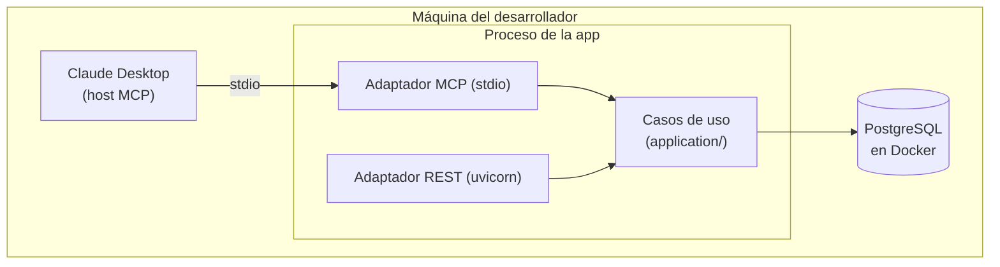
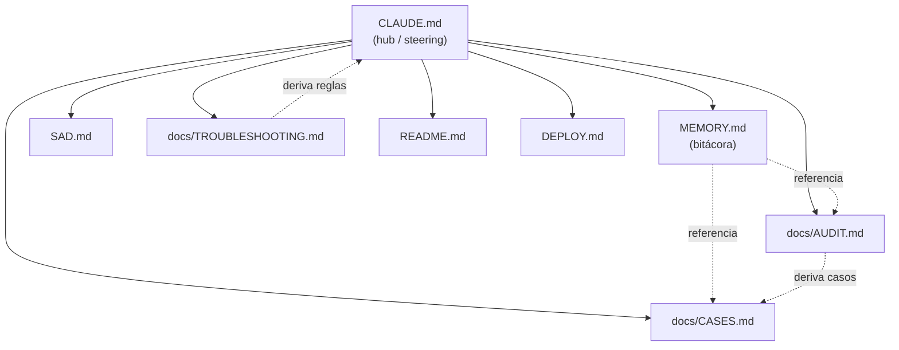

# SAD — Motor de Decisión de Crédito Explicable + Capa MCP

> **Documento de Arquitectura de Software (Software Architecture Document)**
> Estructura: arc42 · Versión: 0.2 (draft) · Estado: aprobado para implementación
> Proyecto: **Veredicto** (identificador técnico: `veredicto`)
> Hub de contexto: ver [`CLAUDE.md`](./CLAUDE.md) y [`MEMORY.md`](./MEMORY.md)
>
> **Cambios v0.2 (revisión crítica):** corrección del diagrama de despliegue; manejo explícito de datos faltantes; simplificación del versionado (política como unidad atómica); motor como intérprete estable con semántica en la política; configuración de scoring en el modelo de política; continuación de `REVISION_MANUAL` (override humano); idempotencia de solicitudes; scoring con enteros (no `float`); activación de política como evento auditado; política de retención de PII; alineación de la firma de simulación.

---

## Tabla de contenido

1. [Introducción y objetivos](#1-introducción-y-objetivos)
2. [Restricciones (constraints)](#2-restricciones)
3. [Contexto y alcance](#3-contexto-y-alcance)
4. [Estrategia de solución](#4-estrategia-de-solución)
5. [Vista de bloques de construcción](#5-vista-de-bloques-de-construcción)
6. [Vista de ejecución (runtime)](#6-vista-de-ejecución-runtime)
7. [Vista de despliegue](#7-vista-de-despliegue)
8. [Conceptos transversales](#8-conceptos-transversales)
9. [Decisiones de arquitectura (ADRs)](#9-decisiones-de-arquitectura-adrs)
10. [Requisitos de calidad](#10-requisitos-de-calidad)
11. [Riesgos y deuda técnica](#11-riesgos-y-deuda-técnica)
12. [Sistema de documentación viva y continuidad de contexto](#12-sistema-de-documentación-viva-y-continuidad-de-contexto)
13. [Hoja de ruta por fases](#13-hoja-de-ruta-por-fases)
14. [Glosario](#14-glosario)

---

## 1. Introducción y objetivos

### 1.1 Qué es esto

Un motor de decisión de crédito que es **determinista, auditable, explicable y configurable**, más una **capa MCP (Model Context Protocol)** que permite a usuarios de negocio (Riesgo, Operaciones) interrogar y simular el comportamiento del motor en lenguaje natural a través de Claude.

El proyecto modela un caso realista de **crédito de consumo chileno**: evaluación de una solicitud contra un conjunto de reglas versionado, produciendo una decisión (aprobado / rechazado / revisión manual) acompañada de un **rastro de auditoría completo** que reconstruye el *por qué* de cada decisión.

No es un CRUD con reglas `if/else`. El núcleo del valor —y de la dificultad— está en tres capacidades:

- **Explicabilidad real:** cada decisión emite un rastro estructurado de qué reglas se evaluaron, con qué insumos, contra qué umbrales y con qué resultado.
- **Configurabilidad dinámica:** las reglas son *datos versionados*, no código. Un tomador de decisión puede crear una nueva versión de política sin desplegar software.
- **Simulación what-if:** reproducir un cambio de regla contra una población histórica de decisiones para medir su impacto *antes* de activarlo en producción.

### 1.2 Objetivos de calidad principales

| Prioridad | Atributo | Por qué es crítico aquí |
|-----------|----------|--------------------------|
| 1 | **Determinismo / Reproducibilidad** | Una decisión de crédito debe ser idéntica dados los mismos insumos y versión de reglas. Es la base de la auditabilidad y de la simulación. |
| 2 | **Auditabilidad** | En crédito regulado (CMF), toda decisión debe ser reconstruible y defendible meses después. |
| 3 | **Explicabilidad** | Riesgo y Operaciones deben entender el *por qué* sin leer código. Es lo que la capa MCP expone. |
| 4 | **Configurabilidad** | El negocio cambia políticas con frecuencia; no puede depender de un ciclo de despliegue para cada ajuste de umbral. |
| 5 | **Testabilidad** | Flujos críticos de negocio exigen cobertura alta y simulación de terceros (buró). |

> **Nota de diseño (criterio senior):** estos cinco atributos no son independientes. El determinismo *habilita* la auditabilidad, la explicabilidad y la simulación. Si el motor no es determinista, todo lo demás se desmorona. Por eso es prioridad 1 y por eso atraviesa casi todas las ADRs de este documento.

### 1.3 Stakeholders

| Rol | Interés en la arquitectura |
|-----|----------------------------|
| Riesgo | Que las reglas sean transparentes, auditables y explicables. Consume la capa MCP. |
| Operaciones | Que el ciclo de apertura de crédito tenga fricción mínima y controles robustos. |
| Producto | Velocidad para iterar políticas sin riesgo. |
| Ingeniería | Mantenibilidad, límites de arquitectura claros, testabilidad. |
| Auditoría / Compliance | Trazabilidad punta a punta. |
| Autor (portafolio) | Demostrar madurez técnica senior: Clean Architecture, SDD, testing, adopción de IA/MCP. |

---

## 2. Restricciones

### 2.1 Técnicas

- **Lenguaje:** Python 3.12+ (excluyente por el rol objetivo).
- **Tipado y validación:** Pydantic v2 + type hints en todo el código de aplicación e infraestructura.
- **Web framework:** FastAPI.
- **ORM y base de datos:** SQLAlchemy 2.0 + PostgreSQL.
- **Inyección de dependencias:** `injector`.
- **MCP:** SDK oficial de Python / FastMCP. Transporte `stdio` para fase local; Streamable HTTP + OAuth 2.1 para fase remota.
- **Contenedores:** Docker para entorno local reproducible.
- **Cloud (fase opcional):** AWS, con foco en SQS/SNS y S3.

### 2.2 Organizativas / de proceso

- **Presupuesto bajo:** la versión portafolio debe correr en ~USD 0 (local + free tiers). Cloud sólo en fase avanzada y opcional.
- **Metodología:** Specification-Driven Development (SDD). El SAD y los specs preceden al código.
- **Continuidad de contexto entre sesiones de IA:** el desarrollo se asiste con agentes; el contexto debe sobrevivir entre sesiones mediante un sistema de documentación viva (ver §12).

### 2.3 Convenciones

- Idioma del dominio en **español** (Solicitud, Regla, Decisión, RastroDecision) para reducir fricción de traducción con el negocio chileno. Infraestructura y nombres técnicos en inglés cuando es idiomático.
- Todo el dinero se modela como entero en **pesos chilenos (CLP)**, sin decimales, con un value object que impide mezclar monedas o usar `float`.
- **El scoring también se modela con enteros** (puntos enteros), no con `float`. La suma flotante introduce no-determinismo sutil entre plataformas/versiones de Python y contradice la promesa de reproducibilidad. Pesos y umbrales de banda son enteros; el score es una suma de enteros. (Ver ADR-006.)

---

## 3. Contexto y alcance

### 3.1 Contexto de negocio



### 3.2 Alcance funcional (qué SÍ hace)

- Evaluar una solicitud de crédito contra un conjunto de reglas y producir una decisión + rastro.
- Versionar conjuntos de reglas (políticas) de forma inmutable.
- Permitir crear/editar versiones de política vía API (configurabilidad).
- Consultar y explicar decisiones históricas.
- Simular el impacto de un cambio de regla contra población histórica (what-if).
- Exponer todo lo anterior, en modo lectura/simulación, vía MCP a Claude.

### 3.3 Fuera de alcance (explícito)

- No entrena modelos ML (la integración ML, si se hace, es de *operacionalización*, fase opcional).
- No es el sistema de originación ni el core bancario; se integra con ellos.
- No incluye desembolso real ni movimiento de dinero.
- No reemplaza al buró real; en el proyecto el buró es un adaptador simulado con fixtures.
- **No incluye el *flujo* operativo de revisión manual** (UI de analista, asignación de casos, colas de trabajo): eso lo maneja un sistema externo. Lo que el motor SÍ modela es el **vínculo auditable** entre la decisión automática y el override humano cuando éste existe (ver §5.2, `DecisionFinal` y ADR-011), para que el rastro no quede roto cuando un humano anula al motor.

---

## 4. Estrategia de solución

| Objetivo de calidad | Enfoque arquitectónico |
|---------------------|------------------------|
| Determinismo | Motor de evaluación como **función pura** con scoring **entero** (sin `float`): sin I/O, sin reloj/azar implícitos, sin estado mutable. El tiempo y los datos externos entran como insumos explícitos. (ADR-006) |
| Auditabilidad | Cada decisión persiste un **snapshot completo de insumos** y un **rastro estructurado** de cada evaluación de regla. (ADR-004) |
| Reproducibilidad estable | El motor es un **intérprete tonto y estable**; toda la semántica de decisión (pesos, agregación, bandas) vive como **dato versionado en la política**. Fijar la versión de política basta para reproducir, aun mientras el motor sigue evolucionando. (ADR-008) |
| Robustez ante datos reales | **Disponibilidad de dato explícita**: cada regla declara su comportamiento ante un insumo ausente/parcial. El motor nunca asume presencia. (ADR-009) |
| Explicabilidad | Reglas con **plantilla de explicación**; el rastro renderiza razones legibles. La capa MCP las traduce a lenguaje natural. (ADR-002) |
| Configurabilidad | Reglas como **datos**, no código; la **política** es la unidad atómica versionada e inmutable. Predicados como árbol estructurado serializable, nunca `eval()`. (ADR-002, ADR-003) |
| Integridad transaccional | **Idempotencia** de solicitudes: misma `idempotency_key` → misma decisión, sin duplicar. (ADR-010) |
| Mantenibilidad | **Clean Architecture** con regla de dependencia estricta hacia el dominio. (ADR-001) |
| Reuso de la capa MCP | MCP y REST son **mecanismos de entrega paralelos** sobre los mismos casos de uso. (ADR-005) |
| Testabilidad | Dominio puro → tests unitarios triviales; buró simulado; **golden-file tests** del rastro. |

La idea fuerza, que conviene tener siempre presente: **si el dominio y los casos de uso están bien hechos, la capa MCP es casi gratis** porque cada herramienta MCP es un adaptador delgado sobre un caso de uso que ya existe.

---

## 5. Vista de bloques de construcción

### 5.1 Nivel 1 — Capas (Clean Architecture)



**Regla de dependencia:** las flechas de dependencia apuntan hacia adentro. `domain/` no importa nada de `application/`, `infrastructure/` ni `interfaces/`. Los puertos (interfaces abstractas) se declaran en el dominio/aplicación; los adaptadores en infraestructura los implementan. `injector` cablea las implementaciones concretas en el arranque.

> **Frontera dura (la que mata estos proyectos si se relaja):** el `domain/` es **stdlib-only** — modelado con `dataclasses` y `enum`, **sin Pydantic** (ni siquiera puro), sin SQLAlchemy, sin FastAPI, sin FastMCP. *(Decisión endurecida en la Vista de halcón de Fase 0: el SAD original permitía un "Pydantic-model puro de dominio"; se descartó para máxima pureza y para que la frontera sea trivial de blindar. Pydantic v2 sigue siendo el estándar en `application/`, `infrastructure/` e `interfaces/`.)* La traducción entidad↔fila vive en los repositorios. Esta frontera se audita en cada fase con `import-linter` (contrato `forbidden` sobre `domain`, ver `AUDIT.md`).

### 5.2 Nivel 2 — Módulos del dominio

```
domain/
├── value_objects/
│   ├── rut.py              # RUT con validación de dígito verificador
│   ├── monto.py            # CLP entero, sin float, type-safe
│   ├── dti.py              # ratio deuda/ingreso en puntos básicos (entero, sin float)
│   ├── plazo.py            # meses
│   └── disponibilidad.py   # DISPONIBLE | NO_DISPONIBLE | PARCIAL (estado de cada insumo)
├── entities/
│   ├── solicitud.py        # Solicitud (+ idempotency_key) + Solicitante
│   ├── insumos.py          # Insumos: contenedor con presencia explícita por campo
│   ├── perfil_crediticio.py# datos del buró (as-seen; puede venir ausente o parcial)
│   ├── regla.py            # Regla + Predicado (AST) + comportamiento ante dato faltante
│   ├── politica.py         # Politica: reglas + ConfiguracionScoring + vigencia
│   │                       #   (UNIDAD ATÓMICA versionada e inmutable)
│   ├── decision_motor.py   # DecisionMotor (salida del motor, inmutable)
│   ├── decision_final.py   # DecisionFinal: DecisionMotor + override humano opcional
│   ├── activacion.py       # EventoActivacionPolitica (auditado: quién/qué/cuándo)
│   └── rastro.py           # RastroDecision + EvaluacionRegla
├── services/
│   ├── motor_evaluacion.py # intérprete PURO y ESTABLE: evalúa
│   └── motor_simulacion.py # replay contra población histórica
└── ports/
    ├── repositorio_decisiones.py
    ├── repositorio_politicas.py
    ├── repositorio_activaciones.py
    └── gateway_buro.py
```

#### Modelo de reglas (el corazón configurable)

Una `Regla` es **dato**, no código. **La unidad versionada es la `Politica`, no la `Regla`**: el `id` de la regla es procedencia (permite seguir "la misma regla" a través de versiones de política), pero una decisión fija únicamente la **versión de política**. No existe versión independiente por regla — eso eliminaría la ambigüedad de "qué versión de la regla aplicó".

```text
Regla  (dato dentro de una versión de Politica; no se versiona por separado)
├── id: str                          # estable entre versiones (procedencia)
├── nombre: str
├── categoria: ELEGIBILIDAD | CAPACIDAD_PAGO | COMPORTAMIENTO | FRAUDE
├── tipo: HARD_STOP | SCORING | WARNING
├── predicado: Predicado             # árbol estructurado, evaluable y serializable
├── peso: int | None                 # ENTERO, sólo para SCORING (sin float)
├── fuente_dato: str                 # qué insumo lee (trazabilidad)
├── ante_dato_faltante: TRATAR_COMO_FALLA | TRATAR_COMO_OK | FORZAR_REVISION
└── plantilla_explicacion: str       # "DTI {valor} supera el umbral {umbral}"
```

El `Predicado` es un **árbol de expresión estructurado** (no una cadena que se evalúa). Por ejemplo `AND(GT(campo="dti", umbral=4500), EQ(campo="situacion_laboral", valor="DEPENDIENTE"))`. Esto lo hace seguro (sin `eval`), serializable a JSON/DB, editable por una futura UI de negocio, y —clave— **explicable**, porque cada nodo conoce el campo, el operador y el umbral que comparó.

#### La política lleva la semántica, no el código

Toda la semántica de decisión vive como **dato en la política**, no en el código del motor. Esto hace al motor un **intérprete estable** y a la política la única cosa que hay que fijar para reproducir una decisión (ADR-008):

```text
Politica  (UNIDAD ATÓMICA versionada e inmutable)
├── id: str
├── version: int
├── producto: str                    # a qué producto de crédito aplica
├── reglas: [Regla]
├── config_scoring:
│   ├── metodo_agregacion: SUMA_PONDERADA   # enum; cambiar la semántica = valor nuevo aquí
│   ├── score_maximo: int
│   └── bandas: [(umbral_min: int, resultado)]  # ej. >=700→APROBADO, 500–699→REVISION_MANUAL, <500→RECHAZADO
└── vigencia: efectiva_desde / efectiva_hasta
```

#### Disponibilidad de datos (el motor nunca asume presencia)

Los insumos reales vienen incompletos: el buró falla, la renta llega nula, no hay historial. Cada insumo tiene un estado de **disponibilidad** explícito (`DISPONIBLE / NO_DISPONIBLE / PARCIAL`). Antes de evaluar una regla, el motor verifica si su `fuente_dato` está disponible:

- Si lo está → evalúa el predicado normalmente.
- Si no → aplica el `ante_dato_faltante` declarado por la regla (`TRATAR_COMO_FALLA`, `TRATAR_COMO_OK` o `FORZAR_REVISION`) y lo registra en el rastro como `NA (dato no disponible)` con la acción tomada.

Así el motor sigue siendo puro y nunca lanza excepciones por datos del mundo real (ADR-009).

#### Lógica de decisión

1. **Hard-stops** primero: si alguna regla `HARD_STOP` falla → `RECHAZADO` (se registra la razón). Corta, pero deja rastro de lo evaluado hasta ahí.
2. **Scoring**: agregación (según `config_scoring.metodo_agregacion`) de las reglas `SCORING` con pesos **enteros** → score entero → bandas definidas en `config_scoring.bandas` (`APROBADO` / `REVISION_MANUAL` / `RECHAZADO`). La comparación de banda es determinista y documentada (`>=` sobre `umbral_min`).
3. **Warnings**: no cambian el resultado, pero se marcan en el rastro.

El motor produce una `DecisionMotor` inmutable. Si la banda resultante es `REVISION_MANUAL`, un humano puede luego decidir un resultado final; esa decisión humana se modela como `DecisionFinal` (envuelve la `DecisionMotor` + actor, justificación, timestamp y resultado final), de modo que el rastro de auditoría no se rompe cuando un humano anula al motor (ADR-011). El *flujo* de revisión (UI, colas) es externo; aquí sólo se modela el vínculo auditable.

### 5.3 Capa MCP — herramientas expuestas

| Herramienta MCP | Caso de uso que envuelve | Modo |
|-----------------|--------------------------|------|
| `consultar_decision(solicitud_id)` | ConsultarDecision | lectura |
| `explicar_decision(solicitud_id)` | ExplicarDecision | lectura |
| `rastro_auditoria(solicitud_id)` | ConsultarDecision (detalle) | lectura |
| `listar_reglas(version?)` | GestionarReglas (read) | lectura |
| `simular_cambio_regla(politica_candidata, poblacion)` | SimularCambioRegla | simulación (sin efectos) |

> **Decisión de seguridad:** por defecto la capa MCP es **read-only + simulación**. `evaluar_solicitud` (operación de escritura que genera una decisión real) NO se expone como herramienta MCP en el MVP. Mezclar lenguaje natural con escrituras de crédito real es un riesgo que no vale la pena para un portafolio (ni para producción sin más controles). La descripción de cada herramienta es deliberada y precisa, porque el modelo la usa para elegir qué llamar.

---

## 6. Vista de ejecución (runtime)

### 6.1 Evaluación de una solicitud

```mermaid
sequenceDiagram
    participant O as Origen (REST/MCP)
    participant UC as EvaluarSolicitud
    participant R as Repositorio
    participant B as Gateway Buró
    participant M as MotorEvaluacion (puro)
    O->>UC: solicitud (+ idempotency_key)
    UC->>R: ¿existe decisión para idempotency_key?
    alt ya existe
        R-->>UC: decisión previa
        UC-->>O: misma decisión (sin recomputar)
    else nueva
        UC->>R: resolver y FIJAR política vigente (versión X)
        R-->>UC: Politica v.X (reglas + config_scoring)
        UC->>B: obtener perfil(rut)
        B-->>UC: perfil (as-seen; puede ser parcial/ausente)
        UC->>M: evaluar(insumos + disponibilidad, Politica v.X)
        M-->>UC: DecisionMotor + RastroDecision
        UC->>R: persistir(DecisionMotor, Rastro, SNAPSHOT insumos, versión X, idempotency_key)
        UC-->>O: DecisionMotor + resumen
    end
```

Dos pasos críticos: **fijar la versión de política al inicio del request** (evita una ventana TOCTOU si alguien activa otra versión a mitad de la evaluación) y **persistir el snapshot completo de insumos** —incluida la disponibilidad de cada dato y el perfil del buró tal como se vio—. Sin el snapshot, la simulación posterior no puede ser fiel (ADR-004); sin fijar la versión, dos requests concurrentes podrían usar políticas distintas de forma no auditable (ADR-008).

### 6.2 Simulación what-if



Nota: la simulación reusa los **insumos guardados**, no vuelve a llamar al buró. Esto garantiza reproducibilidad y evita costo/latencia/no-determinismo de terceros.

> **Límite fundamental del what-if (honestidad de diseño):** sólo se pueden simular cambios que usen datos **ya capturados** en los snapshots históricos. Si la política candidata introduce una regla que lee un `fuente_dato` que no existía cuando se decidieron esos casos, ese dato no está en el snapshot. El motor marca esas reglas como "no evaluables sobre el histórico" y el reporte de impacto lo informa explícitamente, en vez de inventar un valor. Es decir: el what-if está acotado por el esquema de lo que decidiste guardar. (Ver `CASES.md` SI-02.)

---

## 7. Vista de despliegue

### 7.1 Fase local (portafolio, ~USD 0)



> **Nota (corrección v0.2):** MCP y REST son adaptadores **hermanos** que llaman a los mismos casos de uso **en proceso**. El adaptador MCP NO pasa por la API REST (sería un salto HTTP innecesario que acopla dos adaptadores que deben ser independientes). Coherente con ADR-005.

- **Costo:** USD 0. Postgres en Docker local o free tier (Neon/Supabase). MCP en `stdio` = sin servidor que mantener. Claude Desktop como host = sin costo extra de tokens.

### 7.2 Fase remota (opcional, ~USD 10–20/mes)

- Binario/contenedor en VPS chico (~USD 4–6) o AWS (Lightsail / ECS Fargate; free tier inicial).
- MCP remoto vía Streamable HTTP + OAuth 2.1 (alineado con el núcleo *stateless* de la spec 2026-07-28).
- Dominio (~USD 10–15/año) + TLS (Let's Encrypt, gratis).
- Postgres gestionado (free tier o RDS pequeño).
- Detalle operativo completo en [`DEPLOY.md`](./DEPLOY.md).

> **Criterio senior:** no construyas la fase remota hasta que la local esté sólida y auditada. La fase remota agrega auth, TLS y operación que no aportan al *núcleo* del valor demostrable. Es fase 5, opcional.

---

## 8. Conceptos transversales

### 8.1 Manejo de datos sensibles (PII)

RUT, renta y deudas son datos sensibles. Aun en portafolio se modela bien: cifrado en reposo de campos sensibles, control de acceso, y **registro de quién consultó qué** (la propia capa MCP debe loguear accesos). Nunca exponer PII completa en logs ni en respuestas MCP sin necesidad.

**Tensión explícita: retención vs. minimización.** El ADR-004 exige guardar el snapshot íntegro de insumos —con PII— de forma inmutable y por años, para reproducibilidad y auditoría. Eso choca de frente con el principio de *minimización* de datos. No es una contradicción a ignorar, hay que resolverla:

- **Base legal de la retención:** la obligación de auditabilidad de decisiones de crédito (entorno CMF) justifica conservar el snapshot. Esa es la base de licitud para retener, no un "por si acaso".
- **Política de retención definida:** los snapshots tienen un período de retención explícito (alineado a la obligación regulatoria); pasado ese plazo se purgan o se anonimizan irreversiblemente.
- **Pseudonimización:** el snapshot puede guardar el RUT cifrado/tokenizado y separar la PII directa del resto de los insumos, de modo que reproducir una decisión no requiera exponer la identidad.
- **Marco aplicable:** Ley 19.628 y la nueva Ley 21.719 de protección de datos personales. El proyecto las nombra como restricción de diseño, sin pretender cumplimiento legal completo (es un portafolio), pero demostrando que la tensión se entendió.

### 8.2 Estrategia de testing

| Capa | Tipo de test | Herramienta |
|------|--------------|-------------|
| Dominio | Unitario puro + **property-based** (invariante de determinismo) | pytest + Hypothesis |
| Dominio (rastro) | **Golden-file / snapshot** del rastro de decisión | pytest |
| Aplicación | Casos de uso con repos en memoria (fakes) | pytest |
| Infraestructura | Integración contra Postgres dockerizado | pytest + testcontainers |
| Buró | **Simulación de tercero** con fixtures por escenario | mocks/fixtures |
| MCP | Contrato: cada herramienta llama el caso de uso correcto | pytest |

Escenarios de buró simulados (fixtures): perfil limpio, perfil con morosidad vigente, *thin file* (sin historial), ingresos no verificables, RUT con deudas castigadas. Esto materializa el requisito de "dominio avanzado de simulación de servicios de terceros".

> El test de invariante de determinismo (property-based) es el más valioso: genera solicitudes aleatorias y verifica que evaluar dos veces con la misma versión de política produce rastro idéntico. Si alguna vez falla, hay no-determinismo escondido (un `datetime.now()`, un `set` sin orden, un dict no ordenado) — y eso rompería la auditabilidad.

### 8.3 Observabilidad

OpenTelemetry para trazas (fase opcional). El rol valora Elastic APM; el proyecto puede exportar a un free tier de Grafana/Elastic. No es prioritario para el MVP.

### 8.4 Manejo de errores

Errores de dominio (regla mal formada, política inexistente) son excepciones de dominio tipadas, traducidas a códigos HTTP/MCP en las capas de entrega. Nunca tragar excepciones en silencio (anti-patrón explícitamente penalizado por el rol objetivo). Todo error que ocurra durante el desarrollo se registra en [`TROUBLESHOOTING.md`](./docs/TROUBLESHOOTING.md).

### 8.5 Continuidad de contexto entre sesiones de IA

Ver §12. Es un concepto transversal de *proceso*, no de runtime, pero es parte de la arquitectura del proyecto porque condiciona cómo se construye.

---

## 9. Decisiones de arquitectura (ADRs)

> Formato breve: contexto → decisión → consecuencias.

### ADR-001 — Clean Architecture con regla de dependencia estricta
**Contexto:** el rol exige Clean Architecture; el dominio (reglas, invariantes) debe ser independiente de framework y almacenamiento.
**Decisión:** cuatro capas (domain / application / infrastructure / interfaces); dependencias sólo hacia adentro; puertos en el núcleo, adaptadores afuera; cableado con `injector`.
**Consecuencias:** (+) dominio testeable sin DB ni red; (+) REST y MCP intercambiables; (−) más ceremonia inicial (mapeo entidad↔ORM). Aceptado: la ceremonia se paga una vez y habilita todo lo demás.

### ADR-002 — Reglas declarativas como datos (predicado AST), nunca `eval()`
**Contexto:** las reglas deben ser configurables por negocio, serializables, seguras y explicables.
**Decisión:** modelar el predicado como árbol estructurado evaluable; cada nodo conoce campo/operador/umbral; explicación por plantilla.
**Consecuencias:** (+) seguro (sin ejecución de código arbitrario), serializable, editable por UI, auto-explicable; (−) menos expresivo que un DSL Turing-completo. Aceptado: la expresividad limitada es una *feature* en crédito regulado.

### ADR-003 — La política es la unidad atómica versionada e inmutable
**Contexto:** auditabilidad exige saber exactamente qué reglas decidieron cada caso. Versionar reglas individualmente *y* la política a la vez genera ambigüedad ("¿qué versión de la regla aplicó si vive en dos versiones de política?").
**Decisión:** la **`Politica` es la única unidad versionada**. "Editar" crea una nueva versión de política completa (inmutable). Las reglas son contenido dentro de esa versión; su `id` es sólo procedencia, no una llave de versión. Cada decisión referencia exclusivamente la **versión de política**.
**Consecuencias:** (+) reproducibilidad sin ambigüedad; (+) simulación posible; (+) modelo mental simple; (−) crecimiento de almacenamiento de versiones. Aceptado: el almacenamiento es barato; la auditabilidad no es negociable.

### ADR-004 — Snapshot completo de insumos por decisión
**Contexto:** la simulación what-if y la auditoría requieren reconstruir la decisión con los datos *tal como se vieron*.
**Decisión:** persistir junto a cada decisión el snapshot íntegro de insumos (solicitud + perfil de buró as-seen + versión de política).
**Consecuencias:** (+) replay fiel y auditoría a prueba de cambios en terceros; (−) duplicación de datos. Aceptado: sin esto, la simulación es una mentira.

### ADR-005 — MCP como mecanismo de entrega paralelo a REST
**Contexto:** se necesita acceso por API (sistemas) y por lenguaje natural (analistas vía Claude).
**Decisión:** MCP y REST son adaptadores de la capa `interfaces/`, ambos sobre los mismos casos de uso. Ninguna lógica de negocio vive en la capa MCP.
**Consecuencias:** (+) la capa MCP es delgada y barata; (+) un solo lugar para la lógica; (−) hay que diseñar casos de uso pensando en ambos consumidores. Aceptado.

### ADR-006 — Motor de evaluación como función pura con scoring entero
**Contexto:** determinismo es prioridad 1. La aritmética `float` es una fuente sutil de no-determinismo entre plataformas y versiones.
**Decisión:** `MotorEvaluacion` no hace I/O, no lee reloj ni azar, no muta estado; tiempo y datos externos entran como parámetros explícitos. El **scoring usa enteros** (pesos, score y umbrales de banda son `int`), no `float`.
**Consecuencias:** (+) determinismo verificable con property-based testing; (+) trivial de testear; (+) reproducibilidad real entre entornos; (−) el orquestador (caso de uso) carga con el I/O; (−) menos "granularidad" aparente en pesos (irrelevante: se escala). Aceptado: así debe ser.
> **Frontera de reproducibilidad:** "reconstruir exactamente una decisión" significa *mismos insumos + misma versión de política + misma semántica de motor*. La semántica vive en la política como dato (ADR-008), así que fijar la versión de política basta; el motor, al ser intérprete estable, no introduce deriva.

### ADR-007 — Sistema de documentación viva como capa de *steering*
**Contexto:** el desarrollo se asiste con agentes de IA en sesiones separadas; el contexto debe persistir.
**Decisión:** un conjunto de `.md` enlazados (CLAUDE.md como hub, MEMORY.md como bitácora, más AUDIT/TROUBLESHOOTING/CASES/README/DEPLOY) con un protocolo de sesión. Ver §12.
**Consecuencias:** (+) cada sesión nueva reconstruye contexto en minutos; (+) las lecciones no se repiten; (−) disciplina de mantener los docs al día. Aceptado: es la misma filosofía SDD/Friday del autor.

### ADR-008 — Motor como intérprete estable; la semántica vive en la política
**Contexto:** reproducir una decisión vieja exige que la lógica de decisión no haya cambiado. Si la agregación o las bandas viven en código, evolucionar el motor rompe el replay.
**Decisión:** toda la semántica de decisión (pesos, `metodo_agregacion`, `bandas`, `score_maximo`) se modela como **dato versionado dentro de la `Politica`**. El motor es un **intérprete tonto y estable** que ejecuta esa configuración. Cambiar la semántica = un valor nuevo en `metodo_agregacion`, que también queda versionado en la política.
**Consecuencias:** (+) fijar la versión de política basta para reproducir, aun mientras el motor evoluciona; (+) el negocio controla la semántica como dato; (−) el intérprete debe soportar cada `metodo_agregacion` que haya existido. Aceptado: es lo que hace honesta la promesa de auditabilidad.

### ADR-009 — Disponibilidad de datos explícita
**Contexto:** los insumos reales llegan incompletos (buró caído, renta nula, sin historial). Un predicado que asume presencia explota con datos del mundo real.
**Decisión:** cada insumo tiene estado `DISPONIBLE / NO_DISPONIBLE / PARCIAL`. Cada regla declara su `ante_dato_faltante` (`TRATAR_COMO_FALLA` / `TRATAR_COMO_OK` / `FORZAR_REVISION`). El motor aplica esa política y lo registra en el rastro.
**Consecuencias:** (+) el motor sigue puro y no lanza excepciones por datos faltantes; (+) el comportamiento ante ausencia es explícito y auditable; (−) cada regla debe declarar su comportamiento (más diseño por regla). Aceptado: el manejo de datos faltantes ES el problema central de un motor de crédito real.

### ADR-010 — Idempotencia de solicitudes
**Contexto:** en producción la misma solicitud llega más de una vez (reintentos, doble clic, reenvío de cola). Sin protección se generan decisiones duplicadas que ensucian la auditoría.
**Decisión:** toda solicitud porta una `idempotency_key`. Si ya existe una decisión para esa clave, se devuelve la misma sin recomputar.
**Consecuencias:** (+) integridad transaccional y auditoría limpia; (−) hay que persistir y consultar por la clave. Aceptado: es estándar en cualquier sistema transaccional serio.

### ADR-011 — Vínculo auditable entre decisión automática y override humano
**Contexto:** `REVISION_MANUAL` deriva a un humano que a veces anula al motor. Si esa decisión humana no se vincula a la automática, el rastro de auditoría queda roto justo donde más importa.
**Decisión:** modelar `DecisionFinal` que envuelve la `DecisionMotor` + el override humano (actor, justificación, timestamp, resultado final). El *flujo* de revisión (UI, colas, asignación) es externo y fuera de alcance; aquí sólo se modela el vínculo auditable.
**Consecuencias:** (+) trazabilidad punta a punta aun cuando un humano decide distinto al motor; (−) un segundo concepto de decisión a manejar. Aceptado: sin esto, la auditoría miente en los casos más sensibles.

---

## 10. Requisitos de calidad

Escenarios de calidad concretos (formato: estímulo → respuesta esperada):

- **Determinismo:** dada la misma solicitud y versión de política, dos evaluaciones producen rastros idénticos, **en cualquier entorno** (gracias al scoring entero). *Verificable con property test.*
- **Explicabilidad:** ante "¿por qué se rechazó la solicitud X?", el sistema devuelve la lista ordenada de reglas que fallaron con valores y umbrales reales, en lenguaje legible, en < 1 s (objetivo a validar, no garantía).
- **Configurabilidad:** un cambio de umbral genera una nueva versión de política sin tocar ni desplegar código.
- **Simulación:** un analista mide el impacto de una política candidata sobre la cartera del último mes y obtiene cuántas decisiones cambian, sin afectar datos productivos; las reglas que dependen de datos no capturados en el histórico se reportan como no evaluables.
- **Auditabilidad / reproducibilidad:** una decisión de hace 6 meses se reconstruye **exactamente**, aun si las políticas cambiaron desde entonces, porque la decisión fija la versión de política y la semántica vive como dato en ella (el motor es un intérprete estable).
- **Robustez ante datos faltantes:** una evaluación con perfil de buró ausente no lanza excepción; cada regla afectada aplica su comportamiento declarado y queda registrado en el rastro.
- **Idempotencia:** reenviar la misma solicitud (misma `idempotency_key`) devuelve la decisión original sin crear una nueva.
- **Testabilidad:** el dominio alcanza cobertura alta sin necesidad de base de datos ni red.

---

## 11. Riesgos y deuda técnica

| Riesgo | Impacto | Mitigación |
|--------|---------|------------|
| No-determinismo escondido (reloj, orden de dicts, azar) | Rompe auditoría y simulación | Property-based test de determinismo desde fase 1; ADR-006 |
| Fuga de la frontera de arquitectura (ORM en el dominio) | Erosiona Clean Architecture | Auditoría de imports por fase (`AUDIT.md`); linter de fronteras |
| Sobre-ingeniería del modelo de reglas | Retrasa el MVP | DSL acotado, no Turing-completo (ADR-002); empezar con ~8-10 reglas reales |
| Simulación lenta sobre poblaciones grandes | Mala UX en what-if | Motor puro y vectorizable; medir Big-O; paginar/streamear resultados |
| Exposición de PII vía MCP | Riesgo de privacidad | MCP read-only, minimización de datos, log de accesos (§8.1) |
| Activación de política concurrente (TOCTOU) | Dos requests con políticas distintas, no auditable | Fijar la versión vigente al inicio del request; activación como evento auditado (ADR-008) |
| Retención de PII vs. minimización | Conflicto regulatorio (Ley 19.628 / 21.719) | Política de retención explícita + base legal de auditoría + pseudonimización (§8.1) |
| Simulación pide datos no capturados en snapshots | What-if engañoso | Marcar reglas no evaluables y reportarlo, nunca inventar datos (§6.2) |
| Proyecto superficial = daño al portafolio | Contraproducente | Profundo y angosto: una política de consumo realista bien modelada |

**Deuda técnica aceptada conscientemente en el MVP:** sin observabilidad completa, sin auth (MCP local), buró simulado, sin ML. Todo documentado como fase posterior, no como olvido.

---

## 12. Sistema de documentación viva y continuidad de contexto

Esta sección formaliza el sistema de `.md` solicitado. Es una **capa de steering**: documentos que no son sólo referencia humana, sino el mecanismo por el cual un agente de IA reconstruye el estado del proyecto al iniciar una sesión nueva, y por el cual las lecciones aprendidas no se pierden ni se repiten.

### 12.1 Los documentos y su rol

| Documento | Rol | Naturaleza |
|-----------|-----|------------|
| [`CLAUDE.md`](./CLAUDE.md) | **Hub / steering file.** Se lee primero en cada sesión. Contiene misión, invariantes inquebrantables, fronteras de arquitectura, fase actual y un manifiesto que enlaza todo lo demás con un "lee esto cuando…". | Estable |
| [`MEMORY.md`](./MEMORY.md) | **Bitácora.** Registro cronológico de decisiones significativas, transiciones de estado y "dónde quedamos". | Append (crece) |
| [`docs/AUDIT.md`](./docs/AUDIT.md) | **Auditorías por fase.** Checklist + hallazgos + sign-off. Compuerta antes de avanzar de fase. | Append por fase |
| [`docs/TROUBLESHOOTING.md`](./docs/TROUBLESHOOTING.md) | **Bitácora de errores.** error → contexto → causa raíz → solución → regla de prevención. | Append |
| [`docs/CASES.md`](./docs/CASES.md) | **Catálogo de casos borde** por proceso (evaluación, configuración, simulación, MCP). | Append |
| [`README.md`](./README.md) | Cara humana: qué es, setup, cómo correr. | Estable |
| [`DEPLOY.md`](./DEPLOY.md) | Runbook de despliegue (local → remoto). | Evoluciona |
| `SAD.md` (este) | Fuente de verdad de la arquitectura. | Versionado |

### 12.2 Cómo se enlazan



`CLAUDE.md` es el centro. Todo documento lleva en su encabezado un puntero de regreso a `CLAUDE.md`. `CLAUDE.md` + `MEMORY.md` son los dos que un agente lee al iniciar para reconstruir contexto.

### 12.3 Protocolo de sesión

**Al iniciar una sesión:**
1. Leer `CLAUDE.md` (invariantes + fase actual + manifiesto).
2. Leer el final de `MEMORY.md` (dónde quedamos).
3. Leer `docs/CASES.md` y `docs/TROUBLESHOOTING.md` de la fase actual.

**Al cerrar una sesión:**
1. Anexar a `MEMORY.md` qué se hizo y dónde quedó.
2. Registrar en `TROUBLESHOOTING.md` cualquier error nuevo y su prevención.
3. Anexar casos borde nuevos a `CASES.md`.
4. Si se completó una fase, correr la auditoría y registrarla en `AUDIT.md` antes de avanzar.

### 12.4 Relación con la MEMORY del agente

`MEMORY.md` es la memoria *del proyecto*, versionada en el repo y por tanto portable entre herramientas y agentes. Es la fuente de verdad de continuidad; cualquier memoria interna del agente es complementaria, no autoritativa. Si hay conflicto, gana el repo.

---

## 13. Hoja de ruta por fases

Cada fase termina con una entrada de auditoría en `AUDIT.md`. No se avanza sin sign-off.

| Fase | Entregable | Demostrable |
|------|-----------|-------------|
| **0 — Scaffolding** | Estructura de capas, sistema de docs (§12), esqueleto de dominio, Docker+Postgres. | Repo navegable, fronteras definidas. |
| **1 — Motor + rastro** | Evaluación determinista con hard-stops + scoring; rastro de auditoría; REST mínima; tests de dominio + property test de determinismo. | "Evalúo una solicitud y obtengo decisión + por qué." |
| **2 — Configurabilidad** | Versionado inmutable de políticas; API de gestión de reglas; snapshot de insumos. | "Cambio un umbral → nueva versión, decisiones viejas intactas." |
| **3 — Simulación** | Motor de simulación; reporte de impacto what-if. | "Simulo una política candidata contra el último mes." |
| **4 — Capa MCP** | Servidor MCP (stdio) con herramientas read-only + simulación; Claude Desktop como host. | "Le pregunto a Claude por qué se rechazó X y simulo un cambio." |
| **5 — Opcional / Cloud** | AWS (SQS/SNS para workflow de apertura async), observabilidad, MCP remoto + OAuth, integración ML (operacionalización). | Para subir el nivel sin reescribir. |

> **Recomendación de alcance:** las fases 1–4 son el portafolio. La fase 5 es para profundizar áreas específicas que el rol valore en entrevista. Profundo y angosto le gana a ancho y superficial.

---

## 14. Glosario

| Término | Definición |
|---------|------------|
| **Solicitud** | Petición de crédito de un solicitante: monto, plazo, datos personales y financieros. |
| **Regla** | Unidad declarativa de política: predicado + tipo + explicación. Es dato, no código. |
| **Política / ConjuntoReglas** | Colección versionada e inmutable de reglas + configuración de scoring + vigencia. **Unidad atómica de versionado.** |
| **ConfiguracionScoring** | Parte de la política que define método de agregación, score máximo y umbrales de banda. La semántica de decisión como dato. |
| **DecisionMotor** | Salida inmutable del motor: resultado (aprobado / rechazado / revisión manual) + score. |
| **DecisionFinal** | Envuelve la `DecisionMotor` y, si hubo revisión manual, el override humano (actor, justificación, resultado final). |
| **EventoActivacionPolitica** | Registro auditado de qué versión de política se activó, por quién y cuándo. |
| **Disponibilidad de dato** | Estado de cada insumo: `DISPONIBLE / NO_DISPONIBLE / PARCIAL`. Determina cómo actúa una regla ante ausencia. |
| **Idempotencia** | Garantía de que reenviar la misma solicitud (misma `idempotency_key`) no genera una decisión duplicada. |
| **RastroDecision** | Registro estructurado y ordenado de cada evaluación de regla que produjo la decisión. Es el artefacto de explicabilidad. |
| **Hard-stop** | Regla eliminatoria: si falla, rechaza de inmediato. |
| **What-if / Simulación** | Reproducir un cambio de política contra población histórica para medir impacto sin afectar producción. |
| **Snapshot de insumos** | Copia íntegra de los datos tal como se vieron al decidir (incluida la disponibilidad), que habilita reproducibilidad. |
| **Intérprete estable** | El motor no contiene semántica de decisión; ejecuta la configuración de la política. Garantiza reproducibilidad aun mientras evoluciona. |
| **MCP** | Model Context Protocol: estándar para conectar agentes/LLMs con herramientas y datos vía JSON-RPC 2.0. |
| **Puerto / Adaptador** | Interfaz abstracta del núcleo (puerto) e implementación concreta en infraestructura (adaptador). |
| **DTI** | Debt-to-income: ratio deuda sobre ingreso. |

---

*Fin del SAD. Mantener sincronizado con `CLAUDE.md` ante cualquier cambio de arquitectura.*
